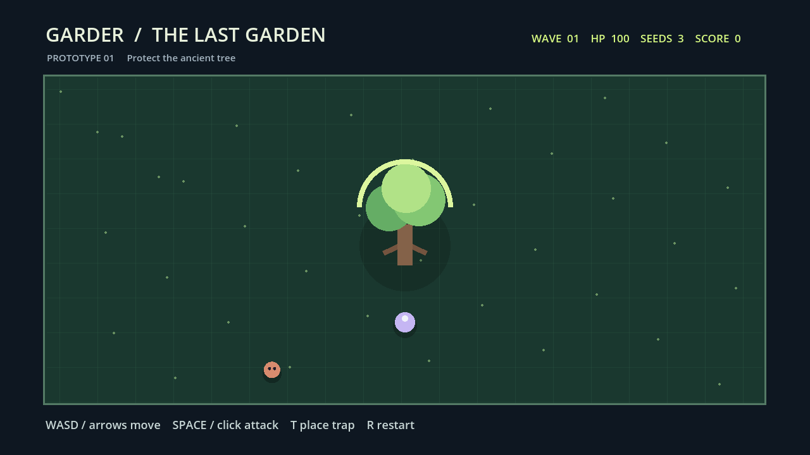

# GARDER · The Last Garden

**Небольшая 2D-игра на Godot 4.2: защищай древнее дерево от волн противников.**



> Важно: на момент этой версии реализована **однопользовательская игровая петля (vertical slice)**. Кооператив, продвинутая экономика, множество биомов и публикация в Steam/itch.io — планы, а не готовые функции.

## Как играть

- **WASD / стрелки** — перемещаться по арене.
- **Space / левая кнопка мыши** — ударить ближайших противников в радиусе.
- **T** — поставить одну защитную ловушку (расходуется семя).
- **R** — начать заново после поражения или во время игры.
- Противники появляются волнами и движутся к дереву. При соприкосновении здоровье дерева уменьшается.
- За обезвреженного врага начисляются очки; после каждой волны добавляется семя.
- Проигрыш — когда HP дерева достигло нуля.

Визуальные элементы рисуются программно в `scripts/Main.gd`: нет сторонних художественных ассетов, обязательной сети или платных сервисов.

## Как запустить

1. Установи [Godot Engine 4.2.x](https://godotengine.org/download/archive/4.2.2-stable/).
2. Клонируй проект:
   ```bash
   git clone https://github.com/safal207/Garder-2d.git
   cd Garder-2d
   ```
3. Открой `project.godot` через Project Manager в Godot, запусти **F6** сцену `scenes/Main.tscn` или **F5** весь проект.

Целевое окно — 1280×720. Для стабильной работы потребуется устройство с совместимой графикой; CI проверяет Linux, но это не доказательство одинакового поведения на всех системах.

## Показ результата, тесты и снимок экрана

```bash
godot --headless --path . --script res://tests/smoke.gd
```

[Правила игры](scripts/GardenRules.gd) тестируются отдельно от графики: число врагов, границы движения, расстояние удара, здоровье и перезапуск. GitHub Actions запускает smoke-тест и отдельную графическую сессию, которая создаёт **реальный PNG-скриншот запущенного Godot-проекта**. Скриншот — не AI-рендер и не рекламная фантазия.

[Исходник скриншота](docs/screenshots/garder-demo.png) · [Проверки CI](.github/workflows/game-ci.yml) · [Задачи на будущее](docs/TASKS.md) · [Game Design Document](docs/GDD.md).

## Структура

```text
scenes/Main.tscn          Игровая сцена
scripts/Main.gd           Игровая петля, векторный рендер и управление
scripts/GardenRules.gd    Детерминированные правила
tests/smoke.gd            Проверка основных инвариантов
docs/screenshots/         Скриншоты из настоящего запуска
docs/GDD.md               Концепция и план расширения
```

## Ограничения и вклад

Это демонстрационный проект, а не коммерчески выпущенная игра. Текущая механика намеренно компактна, чтобы новичок мог добавить собственный тип врага, ловушку, сцену или тест, понять изменение и показать его в портфолио.

Новые задачи и обучение разработке игр также представлены в [AI PATH](https://safal207.github.io/test-it-python/ai-path/). Исторический дизайн-документ в `docs/GDD.md` описывает более широкое видение, а фактические возможности текущей сборки перечислены выше.
